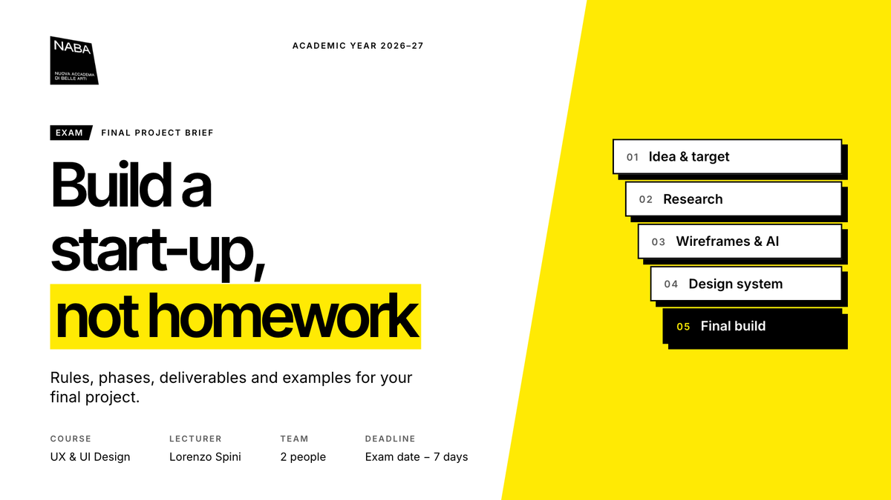
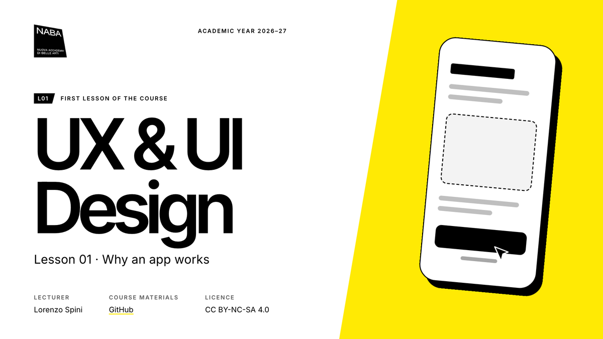
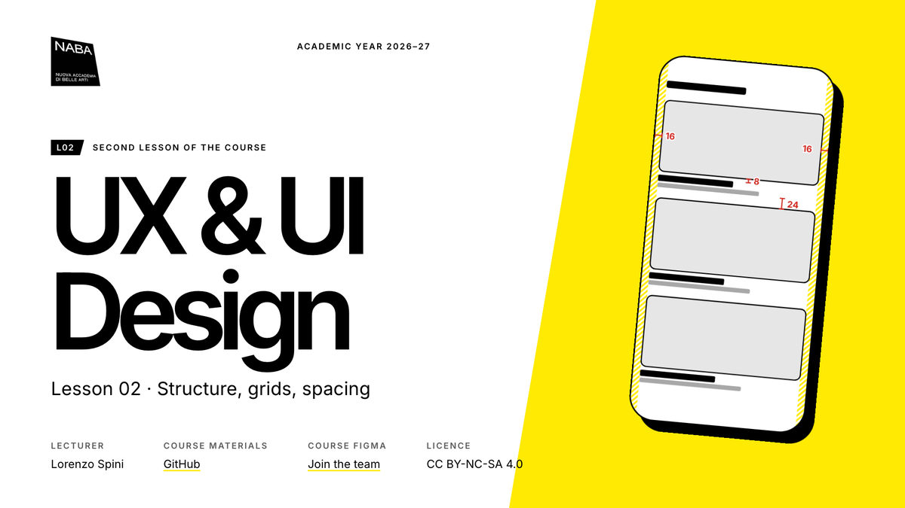
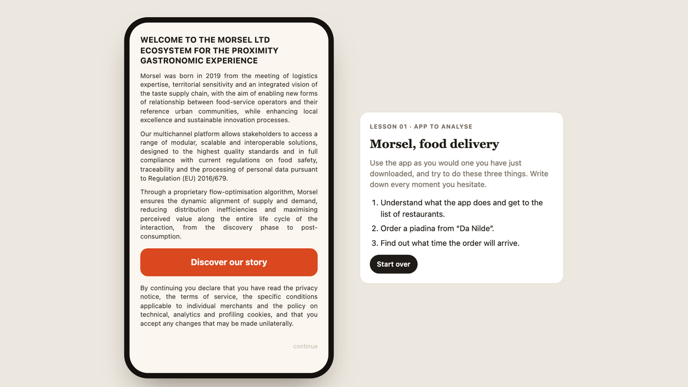

Course materials for **UX & UI Design** at NABA, academic year 2026–27. Lecturer: Lorenzo Spini.
Slides and the brief are protected: the password is given in class.

## Final project

**[Final project brief](https://tigredicarta.github.io/ux-ui-design/brief/)** — rules, phases, deliverables and examples.

## Lessons

| Lesson 01 · Why an app works | Lesson 02 · Structure, grids, spacing |
| --- | --- |
|  |  |
| [Slides](https://tigredicarta.github.io/ux-ui-design/lesson-01/slides/) | [Slides](https://tigredicarta.github.io/ux-ui-design/lesson-02/slides/) |

## Homework apps

| Morsel · Lesson 01 |  |
| --- | --- |
|  | A food delivery app to analyse with the five questions from Lesson 01. Open it on your phone or in the browser: **[Morsel](https://tigredicarta.github.io/ux-ui-design/lesson-01/morsel/)**. |

---

NABA — Nuova Accademia di Belle Arti · Materials licensed CC BY-NC-SA 4.0
