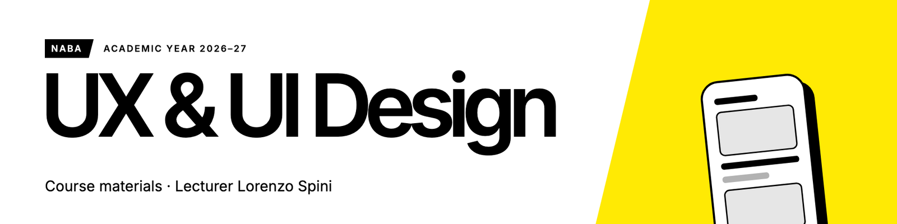
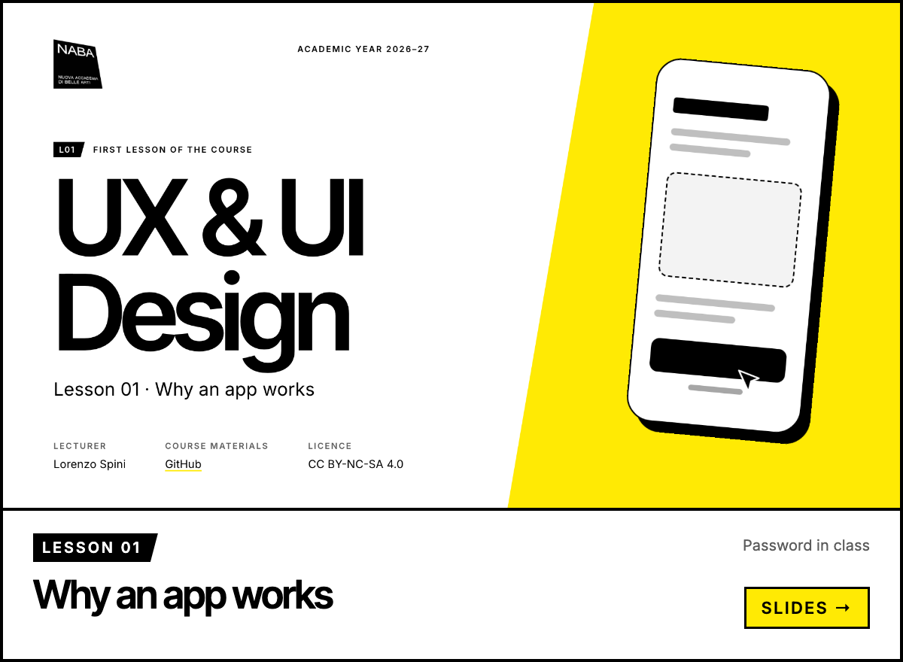
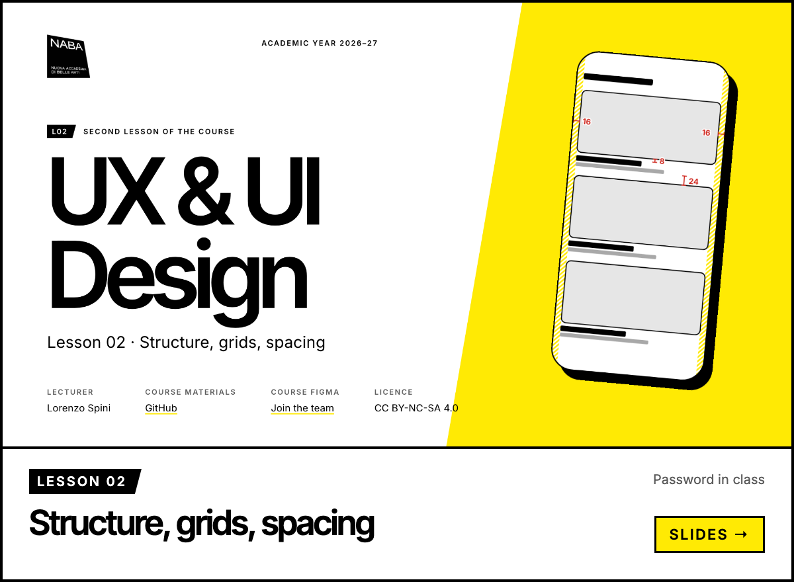
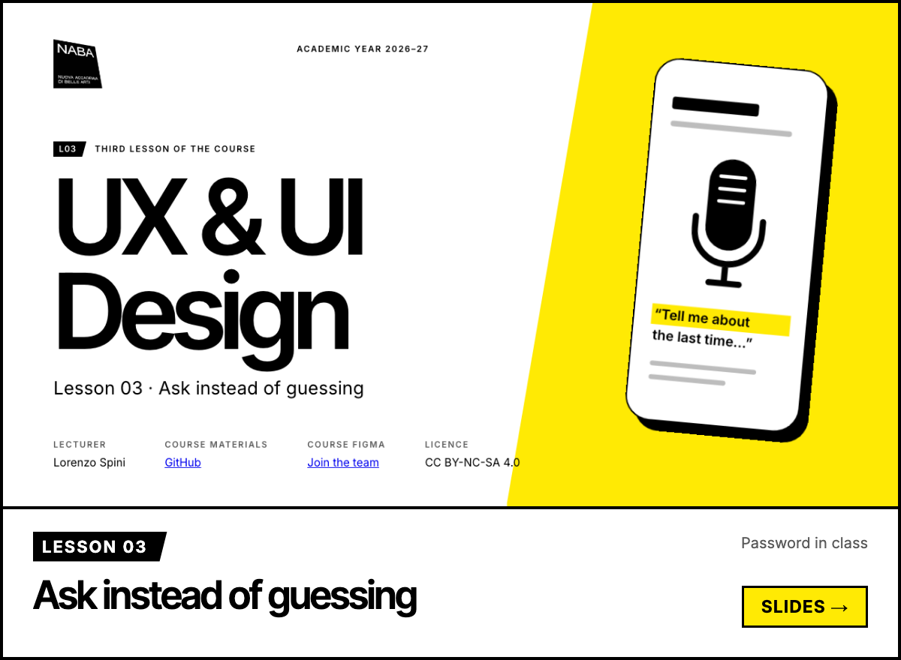
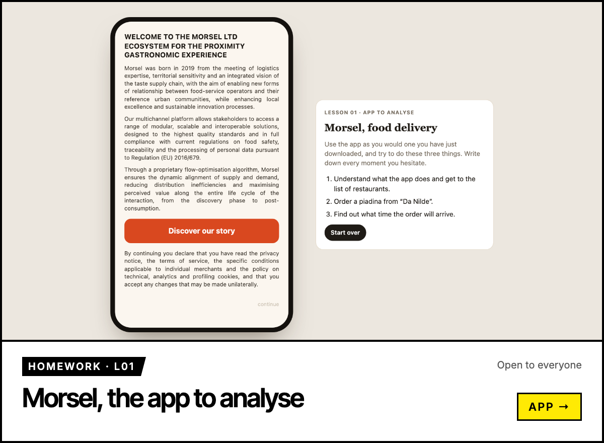
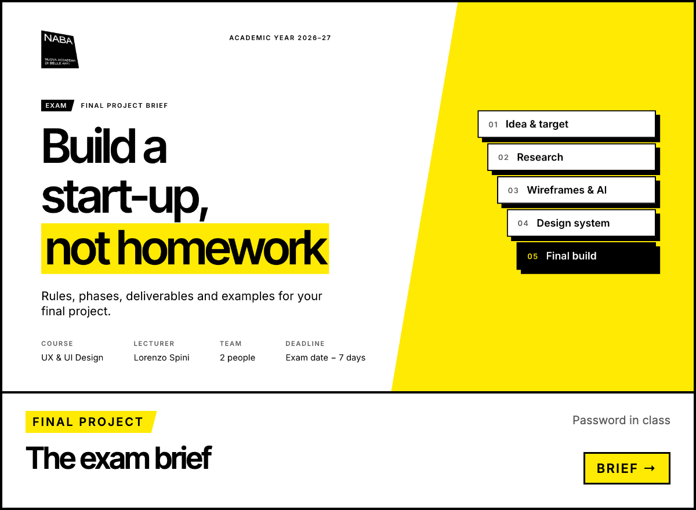

Course materials for **UX & UI Design** at NABA, academic year 2026–27, by Lorenzo Spini. Slides and brief are protected: the password is given in class.

NABA — Nuova Accademia di Belle Arti · CC BY-NC-SA 4.0
