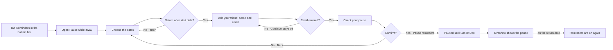

# Flow: pause reminders while away

Action-and-decision flow for the main task. Screen numbers refer to `output/wireframes/index.html`.

1. The person opens the app and taps **Reminders** in the bottom bar. (Screen 1)
2. The reminder overview shows this week's tasks and a row "Pause while away: Off". (Screen 1)
3. The person taps **Pause while away**.
4. The pause screen asks for a start date and a return date. (Screen 2)
5. The person picks the start date and the return date. (Screen 2)
6. **Decision: is the return date after the start date?**
   - **No:** an error says "Return date must be after the start date" and Continue stays off. Back to step 5. (Screen 3)
   - **Yes:** go to step 7.
7. "Who looks after your plants?": the person enters the friend's name and email. The friend gets the care plan for these dates. (Screen 4)
8. **Decision: is the email entered?**
   - **No:** Continue stays off.
   - **Yes:** go to step 9.
9. The person sees "Check your pause": reminders stop, reminders restart, length. (Screen 5)
10. **Decision: does the person confirm?**
    - **No (Back):** back to step 5 with the dates kept.
    - **Yes (Pause reminders):** go to step 11.
11. **Result:** the pause screen shows "Paused until Sat 20 Dec". (Screen 6)
12. The Reminders overview shows a "Paused until Sat 20 Dec" banner and no tasks. (Screen 7)
13. **Result:** on the return date, reminders restart on their own. The overview shows "Reminders are on again". (Screen 8)

## Diagram (Mermaid)

